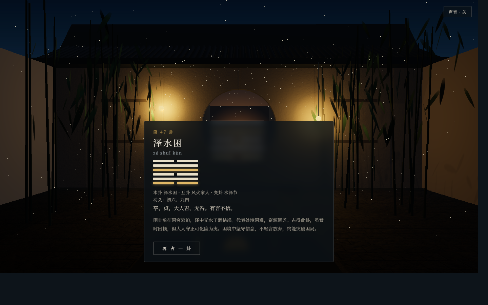

# 六爻 · 易经六十四卦

一个写实风格的 3D 在线起卦工具：走进一方庭院，在石桌前掷六次铜钱，逐爻成卦。

**在线体验：<https://karry-2026.github.io/Six-Yao/>**



## 功能

- **3D 庭院场景**：程序化几何 + CC0 PBR 贴图，IBL 环境光与实时阴影
- **四种氛围**：晴昼 / 烟雨 / 暮夜 / 雪夜，按北京时间自动切换，`?theme=` 可指定
- **起卦流程**：三枚铜钱落桌 → 六爻逐爻亮起 → 本卦、互卦、变卦推演
- **结果解读**：卦名、卦辞、白话解读、动爻标注（初九…上六）
- **环境音**：WebAudio 合成的风声与钟磬，默认静音，可随时开关
- **开场镜头**：4 秒推进入院，可跳过；`prefers-reduced-motion` 时自动跳过
- **降级**：无 WebGL 的设备回退到静态海报，功能与信息完整

## 技术栈

| 层 | 选择 |
|---|---|
| 站点框架 | Astro 5（静态生成） |
| 3D | three.js（WebGL2），程序化场景 + 局部后处理 |
| 语言 | TypeScript |
| 部署 | GitHub Actions → GitHub Pages |
| 素材 | Poly Haven CC0（HDRI / 灰泥 / 石材），明细见 `docs/ASSETS.md` |

## 本地开发

```bash
npm install
npm run dev      # http://localhost:4321/Six-Yao/
npm run build    # 产物在 dist/
npm run preview  # 以 /Six-Yao 前缀预览构建产物
npm run verify   # 64 卦数据、掷币规则、互卦/变卦推演校验
```

## 目录

```
src/
├── pages/index.astro     # 海报、界面、结果卡
├── scripts/scene.ts      # 场景、主题、光照、起卦交互
├── lib/hexagram.ts       # 掷币与卦象推演
├── lib/ambient.ts        # WebAudio 环境音
├── data/hexagrams.json   # 六十四卦数据
docs/                     # PRD、架构、设计、路线图、素材与托管预算
scripts/verify-hexagrams.mjs
.github/workflows/deploy.yml
```

## 文档

- [产品需求](docs/PRD.md)
- [技术方案](docs/ARCHITECTURE.md)
- [视觉与 3D 设计](docs/DESIGN.md)
- [开发计划](docs/ROADMAP.md)
- [实现说明](docs/IMPLEMENTATION.md)
- [素材清单与许可](docs/ASSETS.md)
- [托管容量预算](docs/HOSTING.md)

## 许可

代码以 [MIT](LICENSE) 发布；外部素材均为 CC0，来源记录在 `docs/ASSETS.md`。

## 免责声明

本工具依据中国传统《周易》六爻占法编写，仅供文化研究与娱乐参考。卦象解读基于传统易学理论，不构成任何专业建议。
